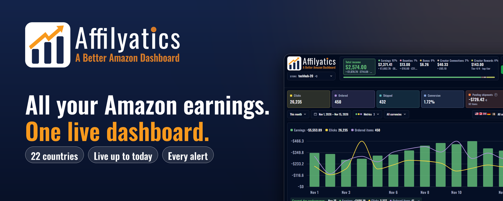
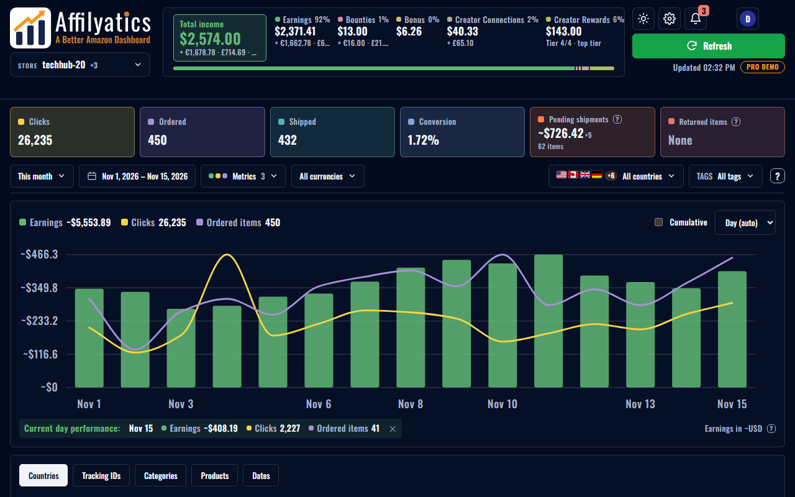
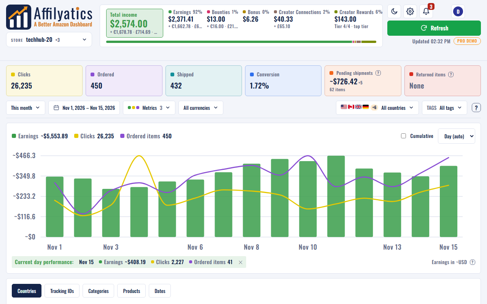
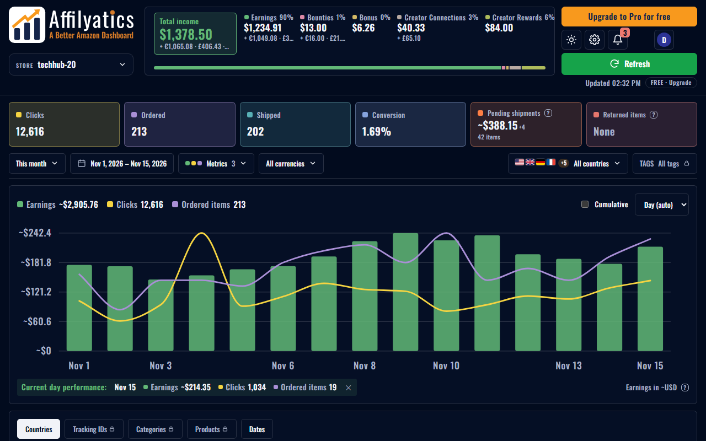

<picture>
  <source media="(prefers-color-scheme: dark)" srcset="icons/logo-dark.svg">
  
</picture>

### All your Amazon earnings. One live dashboard.

A Chrome extension that turns Amazon Associates reporting into one live dashboard: every store, every country, every alert, up to today.

**[Add to Chrome](https://chromewebstore.google.com/detail/pikaeildnladnpjcakoglpheegipkokg)** &nbsp;·&nbsp; **[Live demo](https://affilyatics.com/demo/)** &nbsp;·&nbsp; **[Website](https://affilyatics.com)** &nbsp;·&nbsp; **[Privacy](https://affilyatics.com/privacy/)**

## What it does

Amazon gives you one Associates site per country and one store at a time. Affilyatics reads your own reports through the Associates session you are already signed in to, and puts everything on one screen: total income, clicks, orders, shipped items, conversion, pending shipments and returns, with a chart and tables you can slice by store, country, tracking ID, category and product.

It never asks for your Amazon password. It runs in your browser.

## Screenshots

<table>
  <tr>
    <td width="50%"></td>
    <td width="50%"></td>
  </tr>
  <tr>
    <td align="center">Dark mode</td>
    <td align="center">Light mode</td>
  </tr>
  <tr>
    <td width="50%"></td>
    <td valign="top">
      <b>Try it first.</b> The <a href="https://affilyatics.com/demo/">live demo</a> runs the real dashboard on sample data, no install, no account.  
      Screenshots show the demo data.
    </td>
  </tr>
</table>

## Features

- **Every store, every country.** All your stores and marketplaces in one place, each country in its own currency. Filters cascade: each one only offers what the previous one leaves.
- **Found automatically.** Amazon runs a separate Associates site for each of its 22 countries. Affilyatics finds the ones where you have an account and adds their stores and countries by itself (Pro), and keeps looking in case you open a new one.
- **Live up to today.** Today's clicks, orders and earnings refresh while your browser is open.
- **Total income card.** Earnings, bounties, bonuses, Creator Connections and Creator Rewards (with your tier), with each source's share.
- **Interactive chart and tables.** Earnings bars with clicks and orders curves; tables by country, tracking ID, category, product and day.
- **Real exchange rates.** Several currencies can be drawn together in US dollars at today's rate (marked with `~`); the exact amount of each currency is always one hover away.
- **Alerts.** A bell with new orders, commissions, bonuses, Creator Rewards tiers, sign-out and report warnings, plus optional desktop notifications.
- **Honest estimates.** Pending shipments and returns are marked and explained.
- **Report-gap protection.** If Amazon's report drops a recent day, the last known values are kept and flagged ([details](docs/AMAZON_REPORT_GAP.md)).
- **Light and dark mode**, and your filters are remembered.

## Free and Pro

| | Free | Pro |
|---|---|---|
| Stores | 1 (your main store) | Unlimited, including other countries' Associates sites |
| Total income, chart, countries and dates tables | yes | yes |
| Periods | today to years, custom ranges | all |
| Tag filters, tracking ID / category / product tables | | yes |
| Creator Rewards tiers and enrollment alerts | | yes |
| Alerts | new orders, sign-outs, report problems | all types and desktop pop-ups |
| Updates | every 30 minutes | every 5 minutes |
| Report-gap protection | | yes |

Every new account gets **14 days of Pro, no credit card**. Prices and details: <https://affilyatics.com/#plans>. A free account (email or Google) is required, Free plan included.

## Install

- **Chrome Web Store:** <https://chromewebstore.google.com/detail/pikaeildnladnpjcakoglpheegipkokg>
- **From GitHub:** download the code, open `chrome://extensions`, enable *Developer mode*, *Load unpacked* and pick the folder. `manifest.json` carries the extension's public `key`, so every GitHub/unpacked install gets the same fixed id (`fhccbomkecngijcmapafebjbbbmenahl`); Google sign-in needs that, because its return address (`https://<id>.chromiumapp.org/`) is registered for this id. The Web Store package is built without the key and has its own id.

Then sign in to your Amazon Associates account in the same Chrome profile and open the extension.

## Privacy

Your earnings, stores and tags stay in your browser (`chrome.storage`) and never reach us. The only things sent to our server (<https://affilyatics.com>) are what accounts and plans need: a random installation id, the extension version, your plan and your account token (plus a license key if you enter one), a push token so your browser can be told when your plan changes, and a request for today's exchange rates. If you turn on *Share anonymous usage* (off by default), a few counters and the names of the main buttons you press are sent too, never earnings, store names or tags. Full policy: <https://affilyatics.com/privacy/>.

The server code is not part of this repository.

## How it works

1. The service worker reads your reports from the Associates sites with your own session (the same endpoints the Associates pages use) and caches the numbers in `chrome.storage`.
2. The dashboard reads only from that storage: it never talks to Amazon itself.
3. The license server answers with a signed plan (Free, trial, Pro); the extension checks the signature with a public key.

More in [docs/ARCHITECTURE.md](docs/ARCHITECTURE.md).

## Development

No build step. Open `chrome://extensions`, enable *Developer mode*, *Load unpacked*, pick this folder; after editing a file click the extension's reload icon. Quick syntax check: `node --check popup.js && node --check background.js && node --check shared.js && node --check license.js`.

| File | Role |
|---|---|
| `manifest.json` | MV3 manifest. Permissions: `storage`, `alarms`, `declarativeNetRequest`, `identity`, `gcm`; optional `notifications`. Host permissions: the Amazon Associates site of each country, plus the Firebase sign-in endpoint. |
| `background.js` | Service worker: login tokens, fetching, caching, refresh schedule, country and account discovery, exchange rates, notifications, report-gap guard. |
| `license.js` | Account and plan client: email and Google sign-in, signed plan answers, push registration. |
| `popup.js` / `popup.css` / `popup.html` | The dashboard UI. Reads only from `chrome.storage`. |
| `shared.js` | Countries, periods, date helpers, defaults, exchange-rate helpers. |
| `plan.js` | Plan limits and the public configuration (server address, public keys). |
| `theme.js` | Light and dark theme bootstrap. |
| `fonts/`, `icons/` | Oswald font files, the extension icons and the logo. |
| `tools/` | `package.py` (builds the Web Store zip), `set-env.py` (points the extension at a local or test server), `build-demo.js` (builds the website demo). |

## Documentation

- [docs/ARCHITECTURE.md](docs/ARCHITECTURE.md): data flow, storage keys, caching and refresh.
- [docs/CALCULATIONS.md](docs/CALCULATIONS.md): how every derived number is computed (and its limits).
- [docs/ASSOCIATES_SITES.md](docs/ASSOCIATES_SITES.md): how the Amazon country sites and accounts are discovered.
- [docs/AMAZON_REPORT_GAP.md](docs/AMAZON_REPORT_GAP.md): the "Amazon dropped a day" incident and the protection built for it.
- [docs/PLANS_AND_LICENSING.md](docs/PLANS_AND_LICENSING.md): plans and licensing.
- [docs/CHANGELOG.md](docs/CHANGELOG.md): what changed, newest first.

## Support and security

Questions: <contact@affilyatics.com>. Security reports are welcome: write to the same address and give us a reasonable time to fix a problem before you publish it. Please do not access or change other people's data.

## License

Source-available, **not** open source: you can read the code and run an unmodified copy under your own plan, but you may not redistribute it, build on it, or bypass the plan checks. See [LICENSE](LICENSE).

Affilyatics is an independent product. It is not affiliated with, endorsed by or sponsored by Amazon. "Amazon" and "Amazon Associates" are trademarks of Amazon.com, Inc. or its affiliates.
